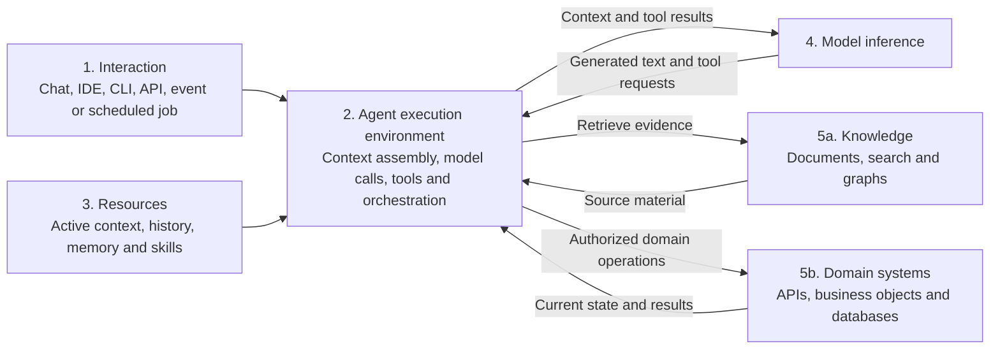

# Separating Responsibilities in Agent Systems

[Practice index](../agentic-engineering.md) · [Field report](../working-with-coding-agents.md)

“The agent” often names several parts of a system at once. Separating those
parts makes ownership clearer: where a person interacts, what runs the loop,
what supplies context, what generates tokens, and what owns business state.
These are responsibilities; several can live in the same application.

## Five Parts of the System

| Part | Responsibility |
| --- | --- |
| Interaction | Let people or systems start, monitor, and direct work through chat, developer tools, APIs, or events |
| Agent execution environment | Assemble context, call inference, execute permitted tools, and manage the working loop |
| Memory and skills | Make relevant context available across steps or sessions; supply reusable task instructions, workflows, templates, and supporting resources |
| Model inference | Produce text or structured requests from the supplied context |
| Knowledge and domain systems | Supply evidence and own authoritative objects, domain rules, and changes to business state |

The execution environment mediates model requests and tool execution. A model
can request an action; actual execution depends on the tools and permissions
available to the environment and on authorization in the called system.

Memory spans different mechanisms. Active context is the material available
for the current model call. Conversation history records an interaction.
Persistent memory retains selected information beyond that interaction.
Each needs a source and freshness appropriate to its use. A remembered
deployment outcome still needs a current system read when present status
matters.

A skill supplies reusable guidance and may include scripts or resources. The
execution environment runs any permitted operations it describes. Installing
a skill does not itself grant credentials or enforce a permission boundary.

## Keep Retrieval and Domain Actions Distinct

Retrieval answers an evidence question: find the requirement, reopen the
decision, or read the relevant source. A domain action performs business work:
revise a theme, record a defect, or request a deployment. Its contract names
the object, checks applicable rules and authority, and returns the result.

Both can be exposed through the same tool protocol. The transport does not
determine their responsibility. A generic storage query wrapped in MCP still
leaves the caller to reconstruct the domain rules; a domain operation can
enforce those rules for every interface that uses it.

Bidcraft illustrates the separation. Its editorial service owns the shared
proposal model and changes to it. CLI, MCP, and the review UI expose that work
through different interfaces. The service does not need to generate model
tokens to supply a question, save an answer, or return source text. The
[workflow guide](multi-step-workflows.md) describes that division in detail.

## Three Working Modes in the Hephaestus Design

Hephaestus's proposed project environment separates three ways of using
agents. This is a design example, not a claim that its full platform is
implemented or deployed.

| Mode | Who directs the work | Contribution and boundary |
| --- | --- | --- |
| Developer-supervised implementation | Developer using their own coding tools, account, and workspace | Design, code, debug, test, and prepare Git changes; the developer retains control of the coding session and commits/pushes |
| Interactive project collaboration | A person working through project chat | Investigate, develop requests, challenge findings, and perform authorized project actions through domain tools |
| Background specialist | A scoped request or configured event | Analyze specified inputs and return evidence-linked findings or proposals, such as security review or feature decomposition |

These working modes are independent of the five system responsibilities.
Interactive project chat may run on a backend. A headless process still needs
an execution environment, inference, context, and tools. Process location
alone does not determine the assignment or its authority.

In Hephaestus's initial design, background specialists do not implement
commits, accept their own proposals, merge changes, or authorize deployments.
They contribute findings and proposed work to the shared project record.
That is a deliberate scope boundary for this design, not a universal property
of headless agents.

Developer coding credentials remain with the developer. Interactive project
tools use the user's application permissions. Managed specialists receive
capabilities appropriate to their assignment. Each mode can contribute to
the same project case without transferring personal coding sessions into
the platform.

## Assign Product Ownership Separately

Hephaestus also names four product responsibilities. They organize the
application around the agent modes:

| Responsibility | Owns |
| --- | --- |
| Project application and domain services | Shared project records, UI/API/MCP, collaboration, and authorized actions |
| Background specialist execution | Job lifecycle, scoped execution, progress, and attributed findings/proposals |
| Delivery integrations | Git and CI references, authorized builds/deployments, and observed outcomes |
| Project kickstart and reference implementation | Maintained reference repositories, engineering guidance, and adoption through ordinary project changes |

These ownership boundaries do not require four services. The reference
implementation work has a maintenance and adoption lifecycle; it need not be
a runtime component. Similarly, a shared project record can preserve decisions
and findings without storing or replaying every developer conversation.

## Use the Separation to Place a New Capability

For a security review, the interaction starts the request. The domain system
records its scope and source revision. The execution environment obtains the
allowed evidence, applies relevant guidance, and calls the model. The model
develops candidate findings. Domain operations retain those findings against
the reviewed revision. The responsible people and existing delivery policy
determine what happens to the change.

This keeps the review attributable and makes a stale result recognizable.
It also gives each failure an owner: missing evidence belongs to retrieval
or source access; unsupported actions belong to tool contracts; an invalid
state change belongs to domain enforcement; a poor assessment calls for
better reasoning, guidance, or review.

When adapting this model, name the canonical records and actions first. Then
choose the interfaces, agent modes, and execution environment needed to use
them. Apply the destination's authorization model; a diagram or prompt does
not create new authority.

## Source Examples

Hephaestus's `README.md`, `docs/agent-execution.md`, and
`docs/project-model.md` describe the proposed modes and domain boundaries.
Bidcraft's `tools/bidcraft-service/README.md` describes the editorial service
example in `opm-clarity`. Repository access is needed to consult those
implementation and design sources, but not to apply the distinctions in this
guide.
