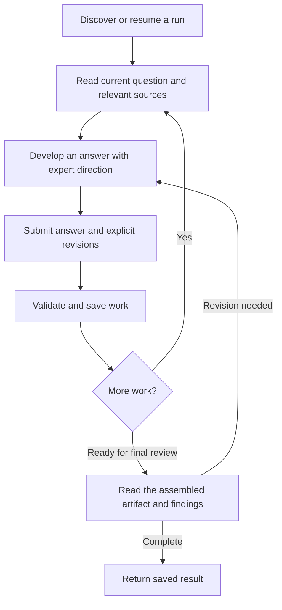

# Multi-Step Workflows That Carry Their Own Context

[Practice index](../agentic-engineering.md) · [Field report](../working-with-coding-agents.md)

A substantial domain task often needs several connected judgments: understand
the evidence, develop an approach, challenge it, write the result, and review
the whole. A guided workflow can retain that work and present the next useful
question with the context needed to answer it.

Bidcraft, the proposal-authoring application in `opm-clarity`, provides a
concrete example. The agent answers substantive business questions. The
application owns the workflow definition, saves the answers, updates proposal
source, and exposes the current state to its CLI, MCP clients, and review UI.
The expert can redirect the argument and revise earlier answers as
understanding develops.

## Put the Sequence in the Domain Application

| Responsibility | Owner |
| --- | --- |
| Define the questions, relationships, and required structural checks | Domain application |
| Read evidence, reason about the problem, and draft an answer | Agent working under the expert's direction |
| Retain answers, review findings, revisions, and current progress | Application's shared work state |
| Decide whether the argument is useful and what direction to pursue | Domain expert, supported by agent analysis |
| Validate a write and update the canonical artifact | Domain operation |

A skill can explain the workflow and when to use it. A durable plan can track
the surrounding assignment. The application's workflow is useful when the
steps operate on domain objects and must keep those objects coherent across
sessions or collaborators.

For a simple repository task, an existing plan and ordinary edits may suffice.
Introduce saved workflow state when resumption, shared work, or coordinated
artifact updates require it. The number of steps alone does not require a
workflow service.

## The Working Loop

Each response needs enough information to continue from the saved state:
the run identity, current question or stage, applicable source references,
the supported response shape, and the next action. The agent should be able to
resume by reading the run, even when the conversation that started it is gone.

## Bidcraft's Win-Theme Example

A win theme is an argument connecting a buyer's need to an approach, a benefit,
and a reason to choose the bidder. Bidcraft's workflow develops that argument
through questions about evidence, mechanism, differentiation, writing, and
review. It also has workflows for narrative threads, solution elements, and
client research.

The CLI presents one question per command. MCP and the review UI can group the
win-theme questions into six stages using the same underlying fields:

| Stage | Work it brings together |
| --- | --- |
| Ground the argument | Requirements, buyer need, and evaluation criteria |
| Develop the approach and advantage | Mechanism, reason to prefer, and supporting differentiators |
| Challenge and refine | Competition, benefit, a concrete walk-through, demonstration, scope, and customer voice |
| Write the argument | Body, headline, and placement in the proposal |
| Review the draft | Evaluator perspective, fit among other themes, and plain language |
| Read back and complete | Coherence of the assembled source and structural findings |

The grouping changes interaction size while preserving the work. A model can
answer a coherent stage together; a single-question run can take smaller
steps. The useful unit follows the domain decision and the person's direction.

In the CLI, `guide start`, `guide response`, `guide revise`, and `guide show`
create, advance, revise, and inspect a run. MCP uses `workflows_list` for
discovery and `guide_advance` for the corresponding actions. Names and input
fields come from discovery rather than being inferred from a display label.

## Make Review Change the Artifact Explicitly

A review finding and a content revision are different contributions. Recording
“the benefit needs to be more specific” should preserve that assessment.
Changing the benefit requires an explicit revision to the authored field.

Bidcraft can accept review answers and revisions together. The result shows
which fields actually changed. Review findings remain distinguishable from
proposal prose, so a later reader can see the argument and its assessment
without confusing one for the other.

While a guided run is open, its source changes through workflow operations.
An unexpected direct file edit stops the next operation rather than being
silently overwritten. After completion, the result is ordinary proposal
source. This gives the active workflow a clear writing boundary without
making the finished artifact dependent on a conversation.

## Retain Only the State the Work Needs

Bidcraft's shared runs preserve answers and their revision history. Service
writes use the latest version and a request ID: a stale version requires a
fresh read, and retrying the same request does not advance twice. CLI writes
use the workspace lock. Collaborators can resume the same run without an
ownership transfer.

Those mechanisms serve concrete needs: shared editing, retries, and consistent
updates to work state and source. They are implementation choices for this
application. A single-user local workflow can use simpler persistence when it
provides the required behavior. Saved state, recovery after interruption, and
support for adding new workflows are separate design decisions.

Carry the selected proposal and edition IDs through a multi-call operation.
A convenient default such as “latest edition” can resolve differently after
another edit; explicit scope keeps the work attached to the intended artifact.

## Leave Judgment Open

The questions organize the work. They do not make every answer correct or
every review appropriate to every assignment. Bidcraft lets a reviewer record
that a review was limited or skipped, with a reason, when the user's
instructions constrain it. Final structural checks still apply. Filtering the
suggested reading changes guidance; source access remains separately governed.

Evaluate both the mechanism and the resulting work. A workflow can save every
answer and pass every structural check while producing a weak argument. Read
the assembled artifact, test its claims against evidence, and ask whether it
serves the intended reader. Workflow completion establishes that the process
finished; substantive quality needs domain judgment.

For another domain, begin with one recurring task and its actual artifact.
Identify the decisions that benefit from guidance, the sources each decision
needs, and the ways new evidence can require revision. Keep those revision
paths visible. Add application state where continuity requires it, and use
[JIT documentation](jit-documentation.md) to expose the current work.

## Source Example

Bidcraft's `docs/guided-workflows.md` describes the shared workflow contract.
Its implementation is under `bidcraft/lib/bidcraft/guide/`, including
`stages.rb`, `prompt.rb`, and `run.rb`.
`bidcraft/lib/bidcraft/editorial/agent_guide.md` describes the MCP working loop.
These sources live in `opm-clarity`; the pattern above is usable without its
proposal content or infrastructure.
